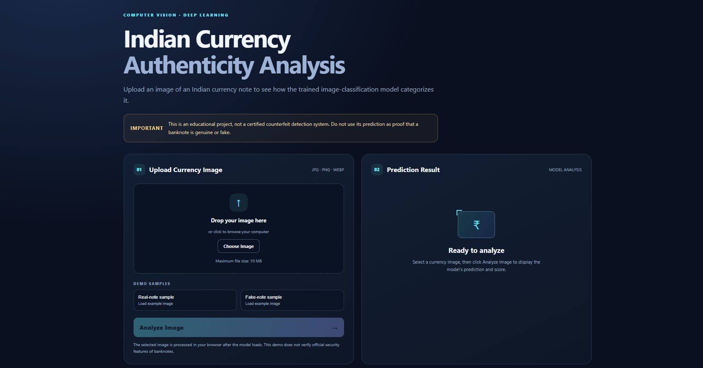
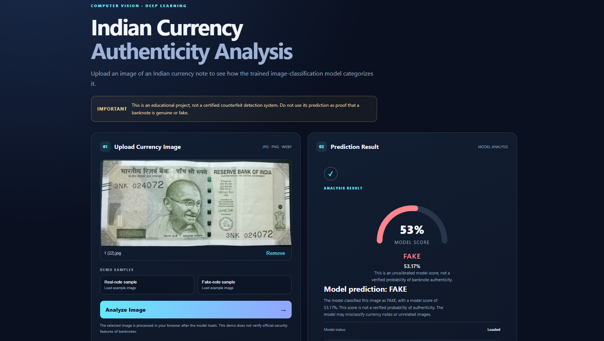
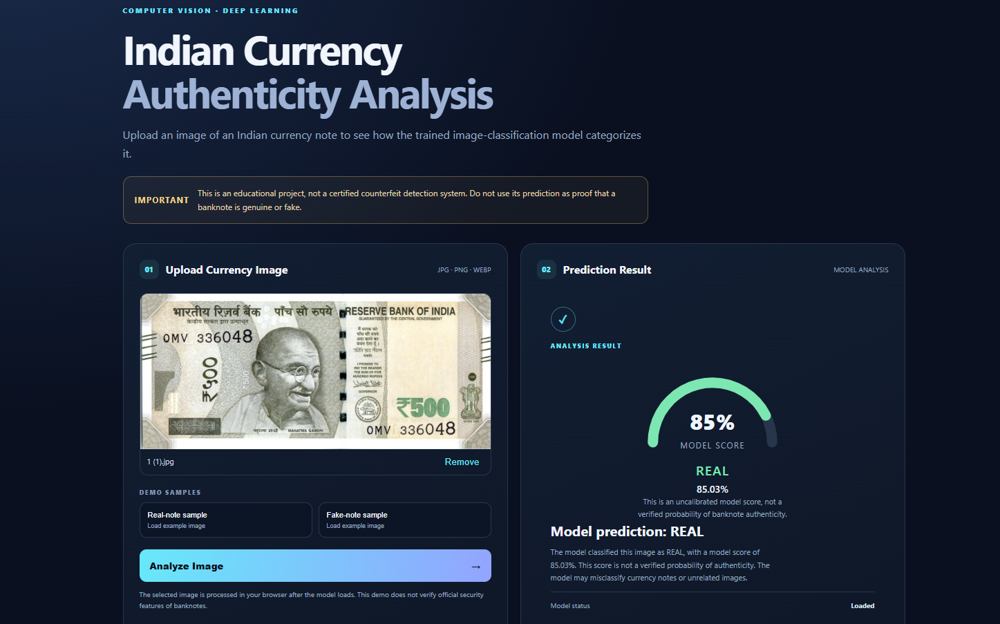

# ₹500 Currency Vision — Browser Demo (No Flask)

A standalone HTML/CSS/JavaScript interface with TensorFlow.js model-loading support. No Flask backend is used.

## Included
- Responsive upload page, local image preview, drag/drop and file checks.
- Two built-in **synthetic demo images** to test the interface.
- Empty train/test folder structure ready for a future verified dataset.
- TensorFlow.js model loader hook.

## Important truth about the data
The included sample images are artificial interface-test graphics labelled as synthetic. They are **not real banknote photos, not genuine/fake ground truth, and must not be used to train or evaluate a currency classifier**. Train/test directories are intentionally empty because verified ₹500 counterfeit labels are not bundled. No trained model or accuracy is claimed.

## Run on Windows
1. Extract the ZIP.
2. Open PowerShell in the extracted project root.
3. Run `cd web` then `python -m http.server 8000`.
4. Visit `http://localhost:8000`.
5. Click Sample A or Sample B, or upload an image. Click Check image status.

Python is only used to serve static files locally; there is no Flask app. Internet access is needed to load TensorFlow.js from its CDN. Alternatively, open `web/index.html` directly for upload/preview, but the built-in samples work best via the local server.

## Dataset layout for later
```
dataset/train/real/
dataset/train/fake/
dataset/test/real/
dataset/test/fake/
```
Use only traceable, correctly labelled ₹500 images. Keep test images separate and avoid duplicates across splits.

## Model integration
PyTorch `.pt` files cannot be loaded directly by TensorFlow.js. The model must be converted/exported to a compatible format, and preprocessing/output class order must match training before enabling predictions. The current UI intentionally reports demo status only.

This educational interface is not an official banknote authentication tool.

## 📸 Website Preview

### Preview 1


### Preview 2


### Preview 3

